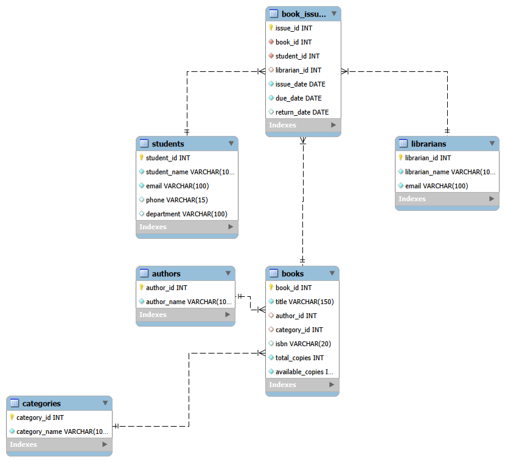

# 📚 Smart Library Management System (DBMS)

A database-driven **Smart Library Management System** developed using C++ and MySQL. This project demonstrates database management concepts, SQL queries, relational database design, and C++ integration with MySQL.

The system is designed to organize library data efficiently through structured database tables and SQL operations.

## 🚀 Project Overview

The Smart Library Management System is a DBMS-based academic project that focuses on designing and managing a library database. It uses MySQL for database operations and C++ for application-level interaction.

The project demonstrates how database concepts can be implemented in a practical library management scenario.

## ✨ Key Features

- **Database Creation:** Structured library database using MySQL.
- **Table Management:** Creation and organization of relational database tables.
- **Data Insertion:** Inserting sample records into database tables.
- **Basic SQL Queries:** Performing essential database operations.
- **JOIN Queries:** Retrieving related information from multiple tables.
- **Advanced SQL Queries:** Implementing advanced database operations.
- **Reports:** Generating useful reports using SQL queries.
- **ER Diagram:** Visual representation of database entities and relationships.
- **C++ Integration:** Connecting C++ application code with MySQL.

## 🛠️ Technologies Used

| Technology | Purpose |
|---|---|
| C++ | Application development |
| MySQL | Database management |
| SQL | Database queries and operations |
| MySQL Connector/C | C++ and MySQL connectivity |
| VS Code | Development environment |
| MySQL Workbench | Database design and ER diagram |

## 📂 Project Structure

```text
Smart_Library_Management_System/
│
├── .vscode/
│   ├── c_cpp_properties.json
│   └── settings.json
│
├── ER_Diagram/
│   ├── Smart_Library_ER_Diagram.mwb
│   └── Smart_Library_ER_Diagram.png
│
├── SQL/
│   ├── 01_create_database.sql
│   ├── 02_create_tables.sql
│   ├── 03_insert_data.sql
│   ├── 04_basic_queries.sql
│   ├── 05_join_queries.sql
│   ├── 06_advanced_queries.sql
│   ├── 07_reports.sql
│   ├── Smart_Library_ER_Diagram.mwb
│   └── smart_libarary.cpp
│
├── README.md
├── Smart Library.session.sql
├── libmysql.a
├── libmysql.dll
├── libmysql.def
├── libmysql64.a
├── libmysql64.def
├── smart_libarary.obj
└── smart_library.exe
```

## ⚙️ Installation and Setup

### 1. Clone the Repository

```bash
git clone https://github.com/shashwatsahu75/Smart_Library_Management_System-DBMS.git
```

### 2. Open the Project

Navigate to the downloaded project directory:

```bash
cd Smart_Library_Management_System-DBMS
```

### 3. Database Setup

- Open MySQL Workbench or your preferred MySQL client.
- Execute the SQL scripts in the following order:

| File | Description |
|---|---|
| 01_create_database.sql | Creates the database |
| 02_create_tables.sql | Creates database tables |
| 03_insert_data.sql | Inserts sample records |
| 04_basic_queries.sql | Basic SQL operations |
| 05_join_queries.sql | JOIN operations |
| 06_advanced_queries.sql | Advanced SQL queries |
| 07_reports.sql | Generates reports |

### 4. Run the C++ Application

Make sure MySQL Connector/C is configured correctly in your development environment, including the required header files and library paths.

The MySQL runtime DLL should be accessible to the application.

Run the compiled application:

```bash
.\smart_library.exe
```

## 🗺️ Entity Relationship Diagram

The project includes an ER diagram representing the database structure and relationships.



## 🎯 Learning Outcomes

Through this project, I explored:

- Relational Database Management Systems (RDBMS).
- Database design and ER modeling.
- SQL DDL and DML operations.
- Complex SQL queries and JOIN operations.
- Database reporting and data retrieval.
- C++ and MySQL integration.

## 🔮 Future Improvements

- Add a graphical user interface.
- Implement user authentication.
- Add book issue and return management.
- Introduce fine calculation functionality.
- Improve database security and validation.

## 👨‍💻 Author

**Shashwat Sahu**

B.Tech Computer Science and Engineering Student

- GitHub: [@shashwatsahu75](https://github.com/shashwatsahu75)

---

⭐ If you find this project interesting, consider giving this repository a star!

**Developed as an academic DBMS project.**
